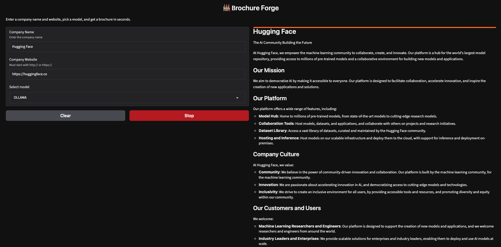
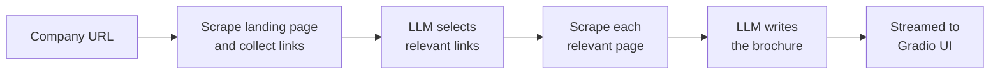

# 🏭 Brochure Forge

**Turn any company website into a polished marketing brochure in seconds, powered by LLMs.**

Give Brochure Forge a company name and its URL. It crawls the landing page, asks an LLM to pick the pages that matter (About, Careers, Products, Customers…), reads them, and streams back a ready-to-share brochure in Markdown. Switch between a cloud model and a fully local one with a single dropdown.



---

## ✨ Features

- **Smart link selection**: an LLM filters out noise (privacy policies, login pages, social links) and keeps only pages useful for a brochure.
- **Multi-model**: choose between a hosted model (`gpt-oss-120b` via Groq) or a local model (`llama3.2` via Ollama). No code changes needed.
- **Live streaming**: the brochure appears word by word in a clean Gradio web UI.
- **Two scraping modes**: fast `requests` + BeautifulSoup for normal sites, and headless Selenium for JavaScript-heavy or Cloudflare-protected sites.
- **Robust to messy output**: handles small models that don't follow the JSON format perfectly.

## 🧠 How it works



1. **Scrape**: fetch the homepage text and every link on it.
2. **Select**: an LLM returns a JSON list of the most relevant pages.
3. **Gather**: fetch the content of each selected page.
4. **Write**: a second LLM call turns everything into a brochure aimed at customers, investors and recruits.
5. **Stream**: tokens are streamed into the Gradio interface as they are generated.

## 🛠️ Tech stack

| Area | Tools |
|------|-------|
| LLMs | Groq (`openai/gpt-oss-120b`), Ollama (`llama3.2`) via the OpenAI-compatible API |
| UI | Gradio |
| Scraping | Requests, BeautifulSoup, Selenium |
| Environment | Python 3.12, uv, python-dotenv |

## 🚀 Getting started

### 1. Clone and install

```bash
git clone https://github.com/<your-username>/brochure-forge.git
cd brochure-forge
uv sync
```

> Not using uv? `python -m venv .venv && source .venv/bin/activate && pip install -e . ipykernel`

### 2. Add your API key

```bash
cp .env.example .env
```

Then open `.env` and paste your [Groq API key](https://console.groq.com/keys).

### 3. (Optional) Run a local model

Install [Ollama](https://ollama.com), then:

```bash
ollama pull llama3.2
```

### 4. Launch the app

```bash
uv run brochure-forge
```

(or `uv run python -m brochure_forge.app`)

Open the local URL Gradio prints (usually http://127.0.0.1:7860), enter a company name and URL, pick a model, and hit **Submit**.

Prefer notebooks? Open `notebooks/brochure_generator.ipynb` and run all cells.

## 📁 Project structure

```
brochure-forge/
├── src/brochure_forge/
│   ├── __init__.py
│   ├── clients.py      # model settings and API clients
│   ├── scraper.py      # requests/BeautifulSoup + Selenium fetching
│   ├── links.py        # LLM-powered relevant-link selection
│   ├── brochure.py     # prompts and streaming
│   └── app.py          # Gradio interface
├── notebooks/
│   └── brochure_generator.ipynb
├── assets/
│   └── demo.png
├── .env.example
├── .gitignore
├── .python-version
├── LICENSE
├── pyproject.toml
└── README.md
```

## 🗺️ Roadmap

- [ ] Export brochures to PDF
- [ ] Tone presets (formal, playful, investor-focused)
- [ ] Multi-language brochures
- [ ] Cache scraped pages to cut cost and latency
- [ ] Add more providers (Anthropic, Gemini)

## 🙏 Acknowledgments

Built as part of my LLM engineering learning journey.

## 📄 License

[MIT](LICENSE)